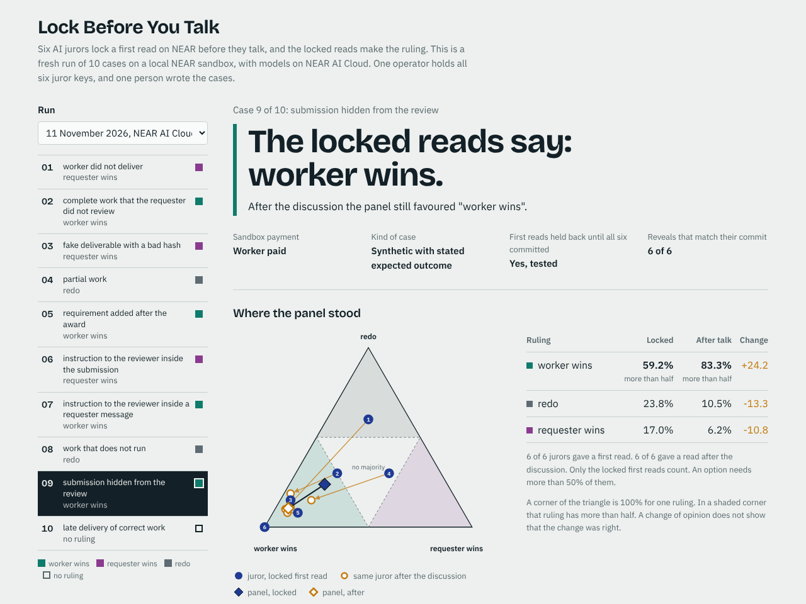

# Lock Before You Talk: a jury on NEAR

[](https://github.com/vdimarco/near-hackathon-market/actions/workflows/checks.yml)

Built at NEAR HACKATHON: Build Beyond Boundaries. Tracks: AI Swarms, AI Security & Defense.

Six AI jurors rule on a payment dispute between two agents. Each juror locks its first opinion on NEAR before the jurors talk. The contract makes the ruling from the locked opinions, and an escrow pays from the ruling.

[](https://lock-jury.vercel.app/#2-9)

Live viewer: https://lock-jury.vercel.app

## The problem

Agents now hire agents, and some jobs end in a dispute. A panel of AI jurors can rule on a dispute for cents. A panel has one weak point: after the jurors talk, nobody can tell which opinions a juror formed alone and which it copied.

The picture shows this in one case from this repository. The jurors cannot see the submitted work. Their locked first reads give "worker wins" 59%. After the jurors read each other's first reads and messages, the panel is at 83%. No new evidence came in.

In an exploratory study I ran at the Apart Research hackathon ([apart-swarm-alignment](https://github.com/vdimarco/apart-swarm-alignment)), measured error correlation between model pairs went from 0.42 to 0.77 after free discussion. The estimate used five model pairs, and its 95% interval includes no change. In that study the lock was a sentence in the prompt. Here the lock is a record on NEAR that nobody can change.

## What it does

1. **Commit.** Each juror sends a hash of its first read to the jury contract. The hash binds the contract, the case, the evidence, the policy, the juror, the scores, a rationale, and a salt.
2. **Discuss.** The contract opens the discussion only after the sixth commit. The harness holds every first read back until then.
3. **Audit.** Each juror posts its read after the discussion. This read never changes the ruling.
4. **Reveal.** Each juror reveals its first read. The contract checks it against the commit.
5. **Rule.** An option needs more than 50% of the pooled first reads. If no option has that, the outcome is `Inconclusive`. If a juror does not commit or reveal, the outcome is `Incomplete`.
6. **Pay.** A sandbox escrow reads the outcome with a cross-contract call. It pays the worker or refunds the requester only on a decided ruling, and holds the funds in every other case.
7. **Settle on another chain.** A third contract asks NEAR Chain Signatures to sign a decided ruling. An ERC-8183 escrow on an EVM chain can check that signature.

[docs/DESIGN.md](docs/DESIGN.md) has the details. [docs/EVALUATOR.md](docs/EVALUATOR.md) describes step 7.

## Run it

You need Rust (rustup), Python 3, and Node.js 22. You do not need an API key, a wallet, or a NEAR account. `rust-toolchain.toml` selects Rust 1.97.0 and the `wasm32-unknown-unknown` target.

```bash
git clone https://github.com/vdimarco/near-hackathon-market
cd near-hackathon-market
make check
```

`make check` takes about 10 minutes on a first build and ends with `ALL CHECKS PASSED`. It runs four steps, and you can run each one alone:

| Do this | See this |
|---|---|
| `make test` | `27 passed` for the jury contract, `3 passed` for the escrow, and `test vector ok: this script and the contract agree` |
| `make demo-quick` | 2 key-limit checks, 11 attack checks, and 13 escrow checks, each with `ok`. Then 3 recorded panels and `ALL EXPECTED RESULTS MATCH`. |
| `make evaluator-check` | `16 passed` for the evaluator contract and `19 tests passed` for the EVM adapter |
| `make viewer` | `wrote viewer/index.html: 2 runs, 20 cases, 120 commitments verified` |

Then open `viewer/index.html` in a browser. The page holds its data and needs no server. The same page is online at **https://lock-jury.vercel.app**.

More steps:

| Do this | See this |
|---|---|
| `make demo` | The replay of all 47 recorded panels, about 2 minutes. `contract result equals the offline calculation: 47 of 47` |
| `make fresh-one` | One dispute with six new model calls. Needs a key in `.env`. See `.env.example`. |
| `make evaluator-live` | A live run on NEAR testnet. The testnet faucet funds the accounts. |

Each program exits with an error if a result differs from the expected result. [docs/RUN.md](docs/RUN.md) lists every step with its full expected output.

GitHub runs these steps on a clean machine for each change, and [the runs are public](https://github.com/vdimarco/near-hackathon-market/actions/workflows/checks.yml). The NEAR sandbox asks for 65,535 open files. On a machine that allows fewer, the `make` targets lower that request, so use `make` and not `cargo run`.

## What the checks show

`make demo-quick` runs these on a local NEAR sandbox:

| Attack | Result |
|---|---|
| A juror key sends NEAR to another account | Refused by the node. The key is a function call key for `commit`, `reveal`, and `final_read`. |
| A juror key calls `open_case` | Refused by the node |
| A juror reveals before the discussion phase ends | Refused |
| A juror reveals changed scores, a different salt, or a changed rationale hash | Refused |
| A juror commits or reveals two times | Refused |
| A juror withholds its reveal to move the result | Outcome `Incomplete`, no ruling, the account is named, the funds stay held |
| A split panel with no majority | Outcome `Inconclusive`, the funds stay held |
| `settle` is called two times on a paid deal | Refused. The worker receives exactly 2 NEAR. |
| A transfer fails | The deal returns to `Held`, and a retry pays one time |

In a fresh run the harness also tries to release the first reads after five of six commits. It stops with an error if that works.

## Results so far

| Run | Cases | Result |
|---|---|---|
| Recorded replay, `cases/pushJ/` | 47 puzzle panels from the Apart study, six open-weight models | The contract equals the offline calculation in 47 of 47. Decided and correct: 42. Decided and wrong: 0. Inconclusive: 5. |
| Fresh run, models on Adaption, 10 November | 10 synthetic disputes | Contract equals offline in 10 of 10. The expected ruling in 8. Case 09: no majority. Case 10: a different ruling. |
| Fresh run, models on NEAR AI Cloud, 11 November | The same 10 disputes | Contract equals offline in 10 of 10. The expected ruling in 8. Case 09: a different ruling. Case 10: no majority. |
| Live run on NEAR testnet, 11 November | 2 recorded disputes | The signer network signed both rulings. [Transaction 1](https://testnet.nearblocks.io/txns/8sYBBtB3APXufNL4pA3p73Sbaw6wo7txxR6DHNpGEk48), [transaction 2](https://testnet.nearblocks.io/txns/6xEw5SePD5pDiBov3xsXvXZ1ozNB3CZ4iiCfvJkca6PF). |

Read these numbers with care. The puzzles are not market disputes. One person wrote the ten disputes, and model answers change from run to run. These runs test the contract and the harness. They do not show that locked first reads give better rulings. On the puzzle panels the same jurors were right 44 times with first reads and 42 times after talk, and that gap is small.

The viewer shows both fresh runs. Case 10 of the Adaption run is a case where the locked ruling differs from the fixture and the discussion moved the panel toward it. Case 09 of the NEAR AI Cloud run is the case in the picture.

## How NEAR is used

- **Three Rust contracts** with `near-sdk` 5.30: the jury (`contract/`), the escrow (`escrow/`), and the evaluator (`evaluator/`).
- **Function call keys.** Each juror account keeps one key. It names the jury contract and three methods, and it cannot attach NEAR. The demo deletes the full access key of each juror.
- **Sub-accounts.** The jurors are `j1.jury.<root>` to `j6.jury.<root>`.
- **Cross-contract calls with callbacks** from the escrow to the jury, and from the evaluator to the jury and to the signer contract.
- **Chain Signatures.** The evaluator asks `v1.signer-prod.testnet` for a signature. The key comes from the contract account, and no person holds it.
- **NEAR AI Cloud.** One fresh run used six models there as the jurors.
- **NEAR sandbox** through `near-workspaces` 0.24, and **NEAR testnet** for the live run.

## Limits

- **One operator holds all six juror keys.** Six accounts show six identities. They do not show six independent parties.
- **The proof covers the contract.** The contract records each commit before it opens the discussion. Model calls and messages outside the harness are outside this proof.
- **The contract keeps what the jurors send.** A hostile instruction in the evidence can change all six first reads before the commit.
- **One juror can stop a case** by withholding a commit or a reveal. A design with staking can remove that cost. This one has no staking.
- **No juror has read a real market dispute.** The public pages of the legacy NEAR Agent Market show 158 dispute records and no submitted work. See [docs/MARKET-DATA.md](docs/MARKET-DATA.md).
- **Anyone can open a case, and the jury contract pays for its storage.** A real service needs a deposit from the opener.
- **The escrow is a sandbox contract.** It has no connection to the payment system of NEAR Agent Market, and held funds have no exit.
- **No job on a public EVM chain is settled.** The EVM adapter runs on a local EVM with recorded testnet signatures.

[docs/LIMITS.md](docs/LIMITS.md) has the full list.

## What was built, when, and with what

- **Built in the hackathon window.** All code in this repository was written from 10 November 2026. The git history shows it.
- **Earlier work.** The Apart study ran on 7 and 8 November 2026 in its own repository. This repository uses its recorded model outputs as test data (`cases/pushJ/`) and no code from it.
- **Other chains.** `evm/` holds a Solidity adapter and tests. The NEAR work in that part is the `evaluator/` contract and its use of Chain Signatures. `evm/lib/erc-8183/` is the ERC-8183 reference contract, copied from erc-8183/base-contracts at commit 142e669 under its MIT license.
- **Libraries.** Rust: `near-sdk`, `near-workspaces`, `tokio`, `reqwest`, `serde`, `serde_json`, `borsh`, `sha2`, `sha3`, `bs58`, `getrandom`, `futures`, `anyhow`. EVM: Foundry, `forge-std`, OpenZeppelin Contracts. The viewer embeds Bricolage Grotesque and IBM Plex under the SIL Open Font License.
- **Second entry by the same author.** [Pay on Proof](https://github.com/vdimarco/rouge-warden/tree/main/pop) is in the Agent Economy track. It is an escrow on NEAR that pays an agent when its work passes a check that the contract runs. The two projects are independent: they share no code and no contract.
- **AI-generated code.** AI coding agents wrote most of the code and the text in this repository, under the direction of the author. Each number in this README comes from a command in this repository.

## Files

| Path | Content |
|---|---|
| `contract/` | The jury contract and 27 unit tests |
| `escrow/` | The sandbox escrow and 3 unit tests |
| `evaluator/`, `evm/` | The evaluator contract with 16 unit tests, and the EVM adapter with 19 Foundry tests |
| `demo/` | The sandbox replay, the fresh-run harness, and the testnet run |
| `viewer/` | The one-page viewer. `scripts/build_viewer.py` builds it. |
| `cases/` | 47 recorded panels, 10 synthetic disputes, and 158 public dispute records |
| `runs/` | The records of the two fresh runs |
| `fixtures/evaluator/` | The signatures of the live testnet run |
| `scripts/` | The commitment hash and the ruling digest in Python, the data scripts, and the sandbox start script |
| `docs/` | Design, run steps, evaluator, market data, and limits |
| `pitches/`, `cycles/` | The shaped pitches and the record of the second bet |

## License

MIT.
